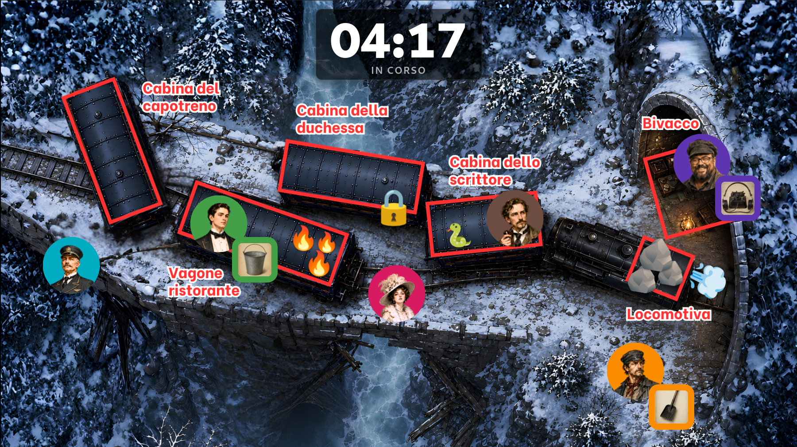
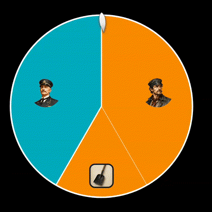

  

<h1 align="center">Storycast</h1>

  <em>A live-action roleplay engine for corporate teambuilding sessions, run from a laptop and a projector.</em> 

  
  
  
  
  
  

---

## Why this exists

This was built while testing a business idea: a teambuilding game format pitched to companies, where groups of participants each play a character in a live, facilitator-run story (a room-scale scene where people move, interact with objects, and face in-fiction conflicts together). Live sessions needed a way to run that fiction in front of a room without a facilitator needing to touch a terminal or a config file mid-session.

The result is a two-window desktop app: a **Control** window for the facilitator (laptop) and a **Stage** window for the audience (projector). Everything the facilitator does updates the projection live, in real time.

> Built for a **non-technical end user**: the in-app UI is entirely in Italian (the facilitator's language), self-explanatory, and forgiving of mistakes.

  
   
  <em>The Stage projection during a live session: the map, with character portraits and their attached objects.</em>

---

## Features

- **Scenarios**: self-contained folders (map, characters, objects, positions).
- **Edit vs. Play**: build a scenario with autosave, then run it live in an ephemeral session.
- **Map + characters**: drag-and-drop circular portraits with manual face crop, colored borders, synced live to the projection.
- **Objects**: assignable to characters, can act as wheel modifiers.
- **Fortune wheel**: resolves conflicts instead of dice: weighted slices, `+1`/`+2` modifiers, a natural decelerating spin, and a probability-consistent outcome.
- **Timer, leaderboard, map annotations, soundboard**

  
   
  <em>The fortune wheel resolving a conflict.</em>

Full feature list in [`docs/USAGE.md`](docs/USAGE.md).

---

## Two-window architecture

Two distinct Tauri windows, each with its own HTML entry point:

| Window | Label | Content |
|--------|-------|---------|
| **Control** | `control` | All controls (asset loading, moving characters, wheel, timer, leaderboard…) |
| **Stage** | `stage` | Read-only: map + characters, or wheel / leaderboard / victory screen when active |

---

## Documentation

- **[`docs/DEVELOPMENT.md`](docs/DEVELOPMENT.md)** — prerequisites, running in dev, building, project structure, scenario file format.
- **[`docs/USAGE.md`](docs/USAGE.md)** — how a facilitator runs a live session.
- **[`CHANGELOG.md`](CHANGELOG.md)** — condensed, milestone-by-milestone summary of what was built and when.

---

## A note on `scenari-bundled/`

The pre-installed demo scenarios (maps, character art, PDFs, audio) are committed directly to this repo rather than through [Git LFS](https://git-lfs.com/), which is the more scalable way to version large binary assets. At the time, this was a local prototype being tested live with real groups, and migrating to LFS wasn't worth the setup until the format proved out. It did, but the project wasn't carried further after that, so the migration was never done. 
